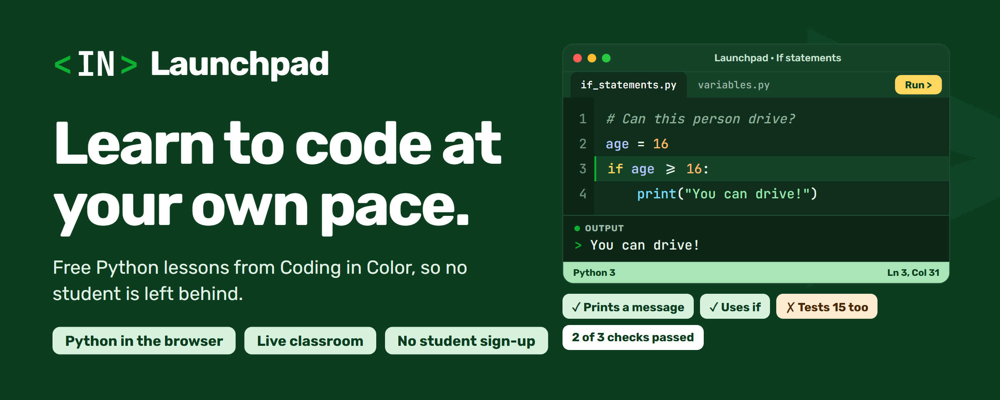
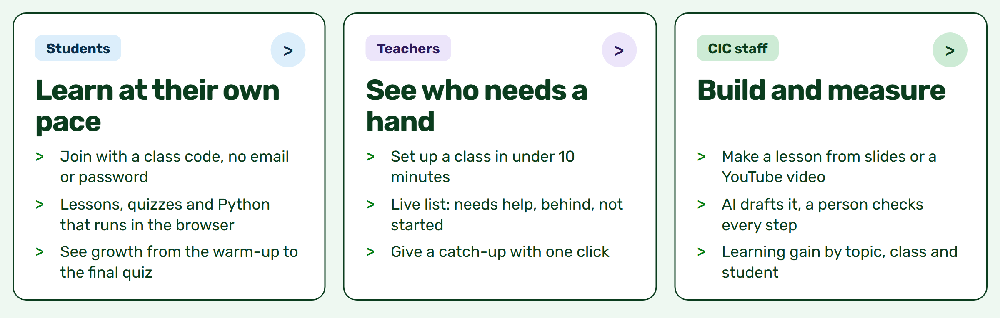
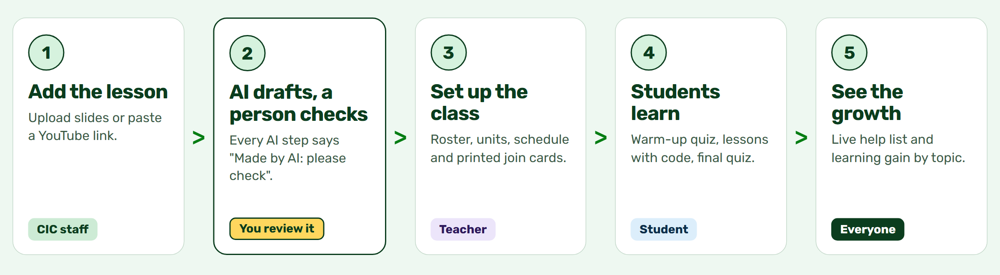
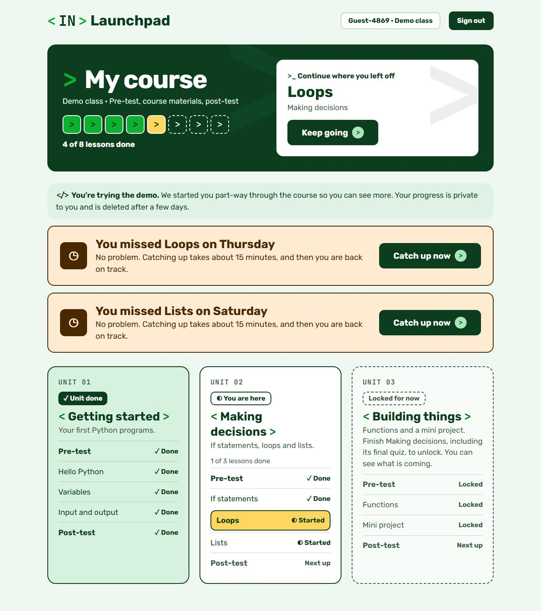
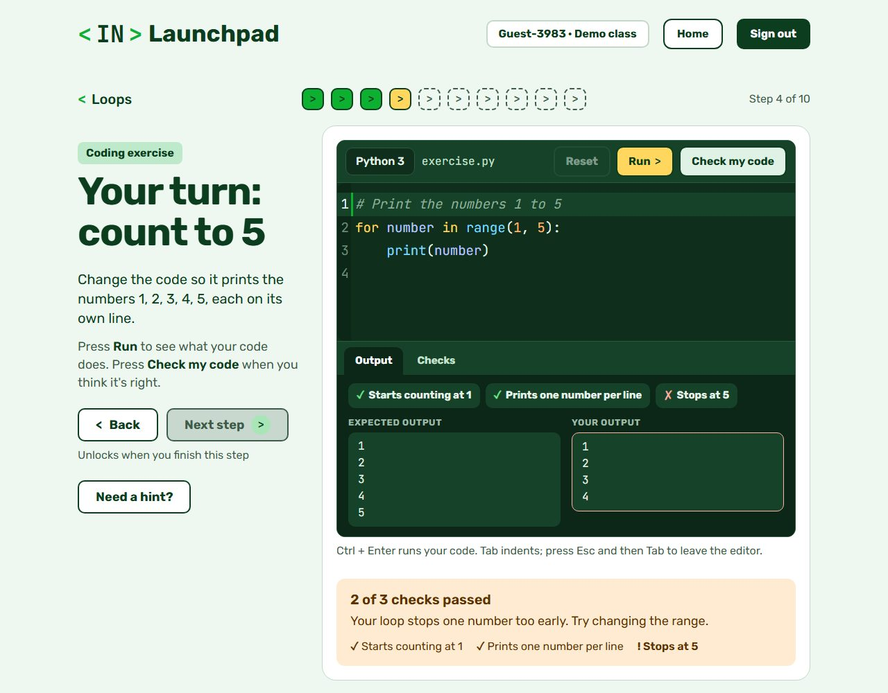
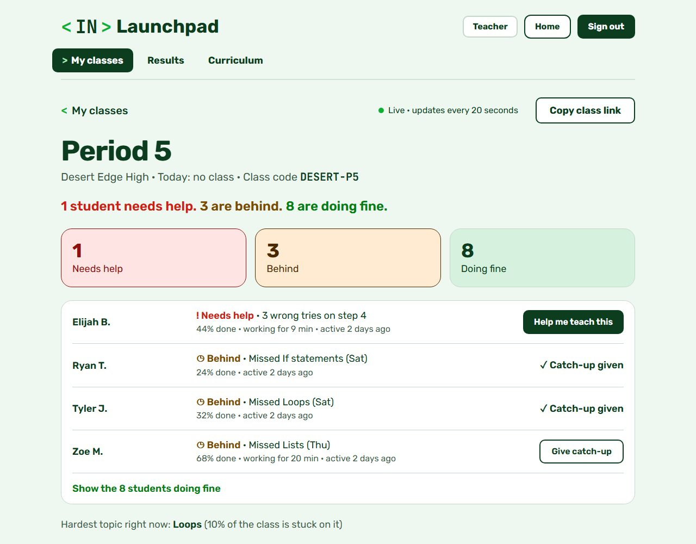
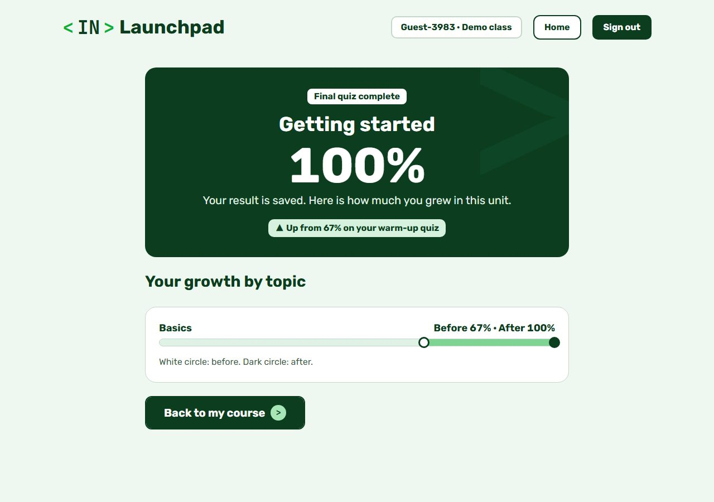
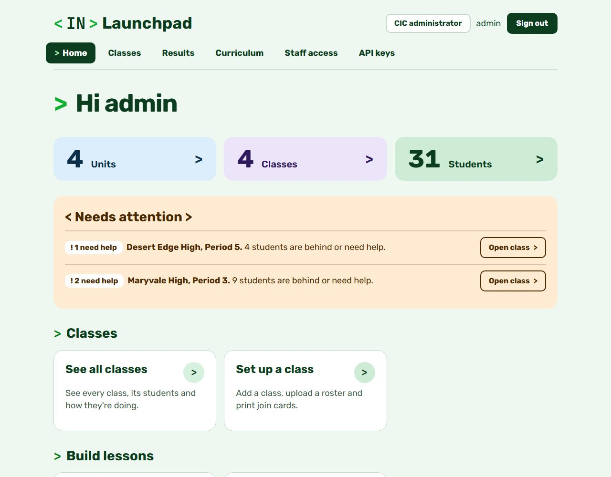

<div align="center">



<br>

[](https://cic-launchpad.vercel.app)   

**[Try it](#try-it-in-a-minute)** &nbsp;·&nbsp; **[What it does](#what-it-does)** &nbsp;·&nbsp; **[How it works](#how-it-works)** &nbsp;·&nbsp; **[Screenshots](#screenshots)** &nbsp;·&nbsp; **[Run it yourself](#run-it-yourself)** &nbsp;·&nbsp; **[Team](#team)**

</div>

<br>

## Try it in a minute

> [!TIP]
> Open **[cic-launchpad.vercel.app](https://cic-launchpad.vercel.app)**, choose **I'm a student: join my class**, and enter class code **`DEMO`** with personal code **`TRYIT`**.
>
> You start part-way through the course with your own private copy, so a quiz, a lesson with code, a worksheet and a catch-up are only a few clicks away. Your progress is yours alone and is deleted after a few days.

<br>

<div align="center"></div>

## Why it exists

[Coding in Color](https://www.codingincolor.net) (CIC) teaches computer science to Arizona high schoolers whose schools don't offer it. Its lessons live in slide decks and printed worksheets, so a partner-school teacher needs real training to run them, nobody knows which module a student is on, and a student who misses a week falls behind.

**CIC Launchpad puts that curriculum on a link.** Students learn at their own pace. Teachers see who is stuck while it is happening. CIC measures how much students grew, by topic, for its reports.

<br>

## What it does

<div align="center"></div>

<br>

<table>
<tr>
<td width="50%" valign="top">

**Python that runs in the browser**<br>
Students write and run real code next to each lesson, with checks that say exactly what passed ("2 of 3 checks passed") and hints one at a time. Nothing is installed and nothing is sent to a server.

**A quiz before and after every unit**<br>
A warm-up quiz shows what a student already knows. The final quiz shows how much they grew, topic by topic.

**Catch-up without shame**<br>
A student who misses a lesson gets a short recap and just the practice they need, in about 15 minutes, then rejoins the class.

</td>
<td width="50%" valign="top">

**A live classroom for teachers**<br>
One plain sentence ("1 student needs help. 2 are behind. 8 are doing fine."), then every student in order of who needs a hand first, with the reason in words.

**Lessons from slides or a video**<br>
CIC staff upload a PowerPoint or paste a YouTube link. AI drafts the questions and a teacher guide; nothing reaches students until a person has checked it.

**Built to be read by everyone**<br>
Big text, clear focus outlines, full keyboard use, and state shown with a word and a symbol, never colour alone.

</td>
</tr>
</table>

<br>

<div align="center"></div>

## How it works

<div align="center"></div>

<br>

## Screenshots

<div align="center">

<br>
<sub><b>My course.</b> Progress at a glance, a clear next step, and catch-ups that are never shaming.</sub>

<br><br>

<br>
<sub><b>A coding exercise.</b> Run it, check it, and see exactly what to fix.</sub>

<br><br>

<br>
<sub><b>The live classroom.</b> Who needs a hand first, and why.</sub>

<br><br>


<br>
<sub><b>Growth you can see</b> (left) and <b>the CIC staff home</b> (right).</sub>

</div>

All names and codes in the demo data are made up.

<br>

<div align="center"></div>

## Built for young people

- **Students are under 18, so we keep as little as possible:** a name, a school and a class. No student emails, no passwords, no accounts.
- **Student code runs in the student's own browser**, not on a server.
- **AI only helps draft lessons.** It never sees anything about students, and a person approves every AI draft before students see it.
- **Everyone sees only what their role needs.** Staff, teachers and students each have their own space.

## Accessibility

We aim for **WCAG 2.2 AA** and check pages with axe and Lighthouse. Everything works with a keyboard, every field has a label, errors are announced to screen readers, text meets contrast guidelines, and the interface is light enough for older school laptops (no animation, small icons, two fonts).

<br>

## Run it yourself

You need Node.js 22 or newer and a free [Supabase](https://supabase.com) project.

```bash
git clone https://github.com/2026-Arizona-Opportunity-Hack/No-1-Left-Behind-CodinginColor.git
cd No-1-Left-Behind-CodinginColor
cp .env.example .env.local   # then fill in the values; the comments in the file say where each one comes from
npm install
npm run dev                  # http://localhost:3000
```

The tables and demo data are in [`supabase/`](supabase/). Never commit `.env.local`.

**No Supabase project? Use a throwaway local one.** With Docker Desktop running:

```bash
npx supabase start               # the first run downloads a few images
node scripts/local-setup.mjs     # loads demo data and prints test logins in your terminal
npm run dev
```

The test logins are random, only work on your own computer, and change every time you run the script. The student join page works with the demo codes above.

Checks: `npm test` (unit tests), `npm run lint`, `npm run build`.

<br>

## Documentation

CIC's brief, the product spec and the build plan are in [`docs/`](docs/).

<br>

## Team

**No 1 Left Behind**, built at the [Opportunity Hack ASU Fall Hackathon 2026](https://www.ohack.dev/hack/fall-2026) for [Coding in Color](https://www.ohack.dev/project/d09466fadf1b11f18e63deadc507a848).

- Shrey Bishnoi ([@shrey-Bish](https://github.com/shrey-Bish)): student experience, teacher and admin screens, deployment
- Maulik Kalpesh Jadav ([@maulik-jadav](https://github.com/maulik-jadav)): curriculum authoring and class setup logic
- Dhanush Koyi ([@dkoyi](https://github.com/dkoyi)): teacher dashboard rules, learning gain, the new design
- Poulami: design, documentation, demo
- Greg

With thanks to our Opportunity Hack mentors. Questions: [#npo-coding-in-color](https://opportunity-hack.slack.com/app_redirect?channel=npo-coding-in-color) on the OHack Slack.

<br>

<div align="center">


**CIC Launchpad.** Small steps, so no one is left behind.

[MIT license](LICENSE)

</div>
